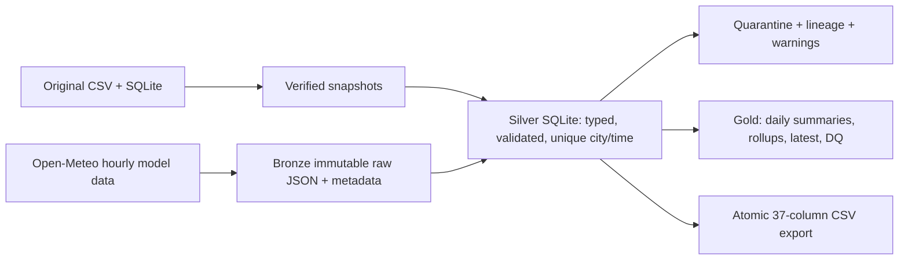

# Maharashtra weather pipeline

[](https://github.com/vijaysgaike/mh-weather-pipeline/actions/workflows/ci.yml)


A lightweight, tested weather pipeline for the cities in the supplied Maharashtra
history. Fetches **Open-Meteo without an API key**, retains raw responses, appends
validated observations to SQLite and a compatible 37-column CSV, and builds
analytics tables. Runs on Python 3.11+ and ordinary laptops; no heavy services.



## Run locally

```bash
make install
make check
.venv/bin/weather-pipeline backfill
.venv/bin/weather-pipeline run
.venv/bin/weather-pipeline validate
.venv/bin/weather-pipeline status
```

The supplied `data/weather.db`, `data/weather_dataset.csv`, and city reference
are **never overwritten**. Working outputs live under `data/silver/`, raw files
under `data/bronze/`, verified snapshots under `data/backups/`, and analytics
exports under `data/gold/`. Quarantine and source lineage live in the working DB.
Bring your own historical sources in these locations when cloning the repository;
source datasets and `.env` are excluded from the code branch. The generated final
dataset is maintained separately on `weather-data`. Tests use small
synthetic fixtures and need neither real data nor network access.

| Command | Purpose |
|---|---|
| `backfill` | Snapshot and reconcile history; insert valid unique records once |
| `run` | Fetch recent completed hours for historical cities; continue on city failures |
| `export-csv` | Recover and republish Silver/Gold exports from the authoritative DB |
| `validate` | Read-only validation of Silver, SQLite integrity, and every CSV cell |
| `status` | Read-only row counts, latest run, and synchronization state |

Use `run --city Pune` (repeat --city for several names) or `run --limit-cities 2`
for a small live run. Global `--config PATH` precedes the command. No API key,
OpenWeatherMap account, or geocoding API is used. The latest conditions are
model estimates, not weather-station observations.

## Configuration

`config.yaml` is deliberately **JSON-compatible YAML**, avoiding an additional
YAML parser dependency. Paths are relative to the configuration file, independent
of your working directory. Do not replace an existing `.env`; `.env.example`
shows optional overrides. Precedence is process environment > adjacent .env >
config > defaults. Unrelated/old provider credentials are ignored and never logged.

Environment overrides: `WEATHER_BATCH_SIZE`, `WEATHER_TIMEOUT_SECONDS`,
`WEATHER_REQUEST_INTERVAL_SECONDS`, `WEATHER_MAX_RETRIES`, `WEATHER_LOG_LEVEL`.
Config also sets `lookback_days` (1–7), `overlap_hours`, `freshness_hours`, city
filters, and paths. Empty `cities` means all accepted historical city identities;
the 224-row reference is not used to add extra cities automatically.

HTTP requests have timeouts, throttling, retry/backoff, Retry-After handling, and
per-city errors. Validated city/time keys are append-only; later model revisions
cannot rewrite existing records. UTC timestamps and numeric values are normalized
at backfill, original IDs are retained in lineage, and missing optional values
remain null. Historical derived values are preserved. Source differences and
all 37 columns are explained in [the dictionary](docs/data-dictionary.md).

SQLite transactions and CSV replacement cannot form one filesystem transaction.
A writer lock and generation marker provide explicit recovery: a crash may leave
a complete old CSV alongside newer DB rows, and the next mutation/export repairs
it before success. `validate` compares full contents, not just row counts.

## Development and automation

```bash
make test
make lint
make check
.venv/bin/pre-commit install
```

Tests block all network connections and use temporary sinks. CI runs Ruff,
strict source typing, and pytest with a >=85% source coverage gate on Python
3.11 and 3.12. Measured coverage is uploaded as a CI artifact; the badge above
labels the required gate. See [verification](docs/completion.md) for local results.

Scheduled GitHub ingestion runs every four hours and commits new accepted data
to the **[weather-data branch](https://github.com/vijaysgaike/mh-weather-pipeline/tree/weather-data)**:

- **Full accumulated CSV:** [weather_dataset.csv.gz](https://github.com/vijaysgaike/mh-weather-pipeline/blob/weather-data/weather_dataset.csv.gz)
  (download and decompress).
- **Browsable CSV files:** [daily/](https://github.com/vijaysgaike/mh-weather-pipeline/tree/weather-data/daily),
  partitioned by year/month/day.
- **Counts and checksums:** [manifest.json](https://github.com/vijaysgaike/mh-weather-pipeline/blob/weather-data/manifest.json).

Each run appends unique observations to Silver and republishes the accumulated
snapshot/daily files, preserving accepted rows. Runs with no new data skip the
Git commit. The separate branch keeps data commits out of code history; the
compressed full snapshot and daily partitions avoid a growing uncompressed
single file. Database audit history and raw JSON remain in the `weather-state`
workflow artifact. If that artifact expires, the workflow rebuilds Silver/Gold
from the committed snapshot; prior raw/audit history needs an external backup.
No API key or external seed URL is required. Push both local branches once:

```bash
git push origin main weather-data
```

Then run **Scheduled ingestion** manually once in Actions, or wait for the
four-hour schedule. See [scheduled operations](docs/scheduled-ingestion.md).

[Runbook](docs/runbook.md) · [Architecture and decisions](docs/architecture.md) ·
[Original inspection](docs/data-inspection.json) · [GitHub setup](docs/github-setup.md)

Open-Meteo attribution: weather data from [Open-Meteo](https://open-meteo.com/),
with [API documentation](https://open-meteo.com/en/docs). Review current usage
terms before using the free service for commercial workloads. The MIT license
covers pipeline code, not third-party weather data.
