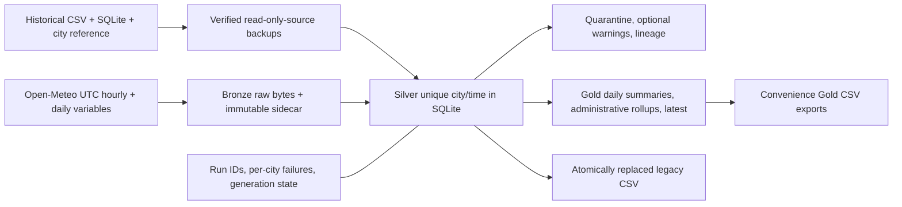

# Architecture and decisions

- SQLite matches the supplied database. Python standard-library streaming CSV/SQL
  avoids loading the 210k-row history into RAM. Pydantic validates row contracts;
  requests supplies HTTP pooling. No heavy compute framework or scheduler service.
- Bronze bytes are untouched, written exclusively by UUID under date/hour
  partitions, fsynced, and indexed with source, run, units/request parameters
  and content digest. Raw error responses are retained; timeouts have no body.
- Silver is append-only and has a unique constraint on city/normalized UTC time.
  Existing integer IDs are preserved where possible; source IDs remain in lineage.
  A deterministic first accepted row wins. Changed provider revisions are retained
  as rejected conflicts rather than rewriting prior accepted data.
- Backfill snapshots originals before use, reconciles CSV/DB by ID and all fields,
  imports main DB by ascending ID then legacy DB then CSV, and commits its complete
  marker in the same transaction. Exact duplicates are counted as skipped;
  conflicts/invalid rows are quarantined. Repeat source fingerprints skip import.
- Historical derived values remain compatible. New values use documented formulas.
  Unknown/missing optional fields remain null with quality warnings; required
  missing fields fail validation. Source model differences are not concealed.
- Single-process fcntl locking serializes all mutations across sinks. SQLite WAL
  transactions commit DB batches. Atomic temp/fsync/replace protects each CSV.
  A generation marker, full-content sync checks and restart repair address the
  gap between DB commit and filesystem replacement. No distributed transaction
  guarantee is claimed. Readers can briefly see an older complete CSV.
- Gold rebuilds transactionally from Silver. Aggregation uses observation samples,
  not assumed regular sampling. Historical aliases remain distinct. Reporting
  mean/max hourly rain avoids invalid accumulation of overlapping history.
- Fatal storage errors stop processing; city API/schema errors do not abort other
  cities. Interrupted run records are marked at the next locked write. Every
  request batch is independently retryable because deduplication lives in SQL.
- Runtime-state artifacts support ephemeral CI runners without publishing raw data
  in Git. State is seeded explicitly and restored with validated paths/checksums;
  expiry is an explicit operational risk documented in the runbook.

See data-dictionary.md for variables and runbook.md for recovery and limitations.
