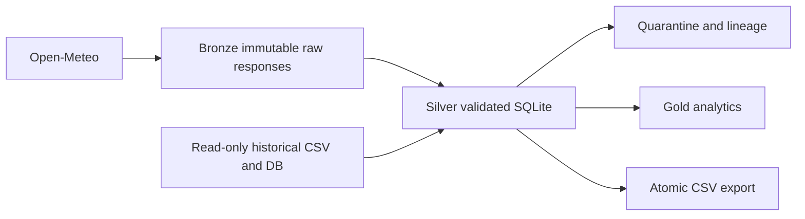

# Architecture

Only M1 configuration and logging are implemented. See design-proposal.md for
planned deduplication, provenance and crash recovery. SQLite and CSV cannot share
one atomic transaction; durable export state will detect and repair interruptions.
Do not run backfill against supplied files as output paths. No data migrations
are part of M1. Make verified backups before M3.
